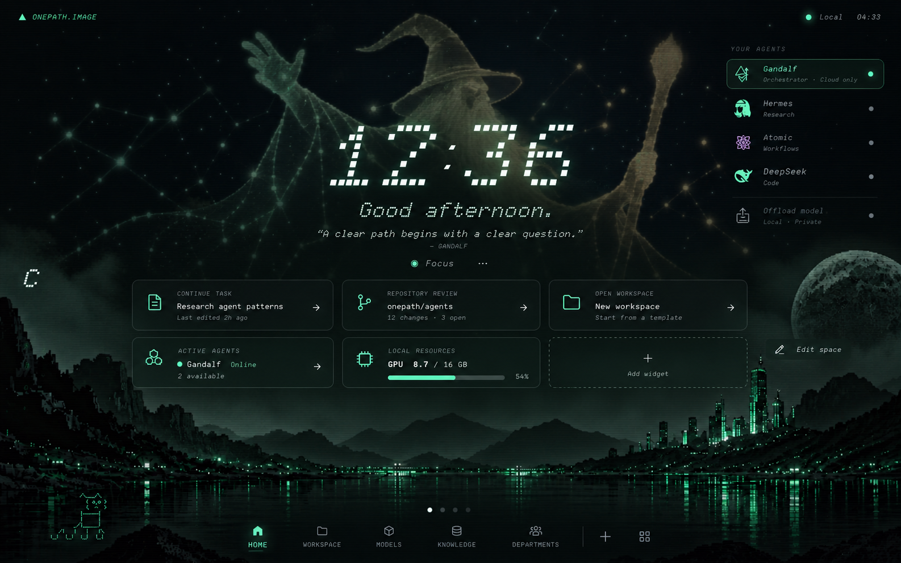
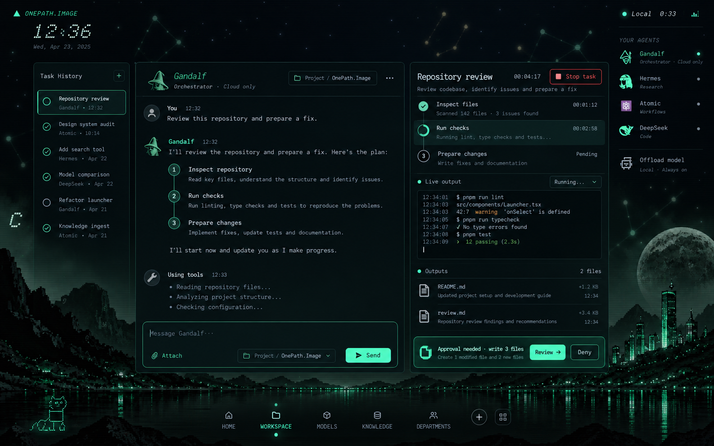
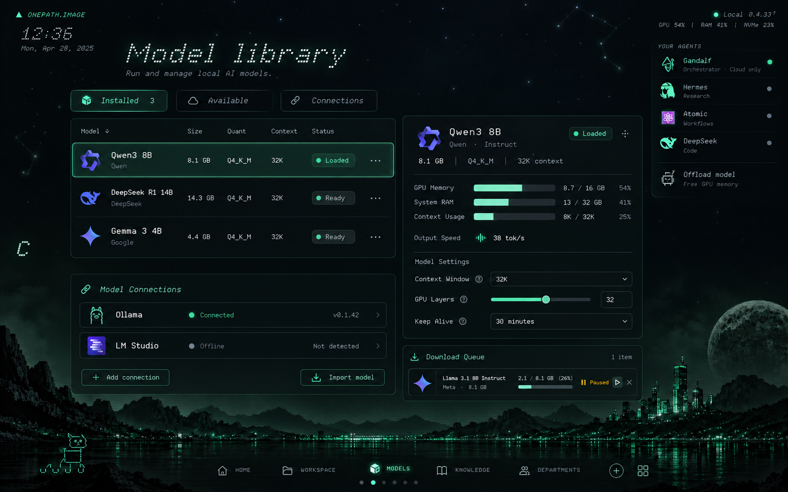
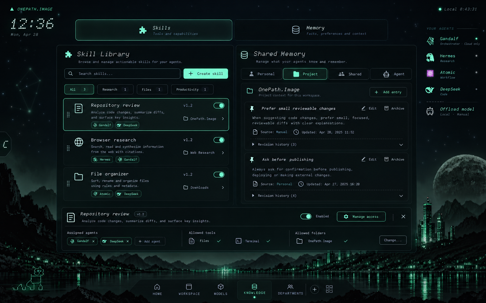
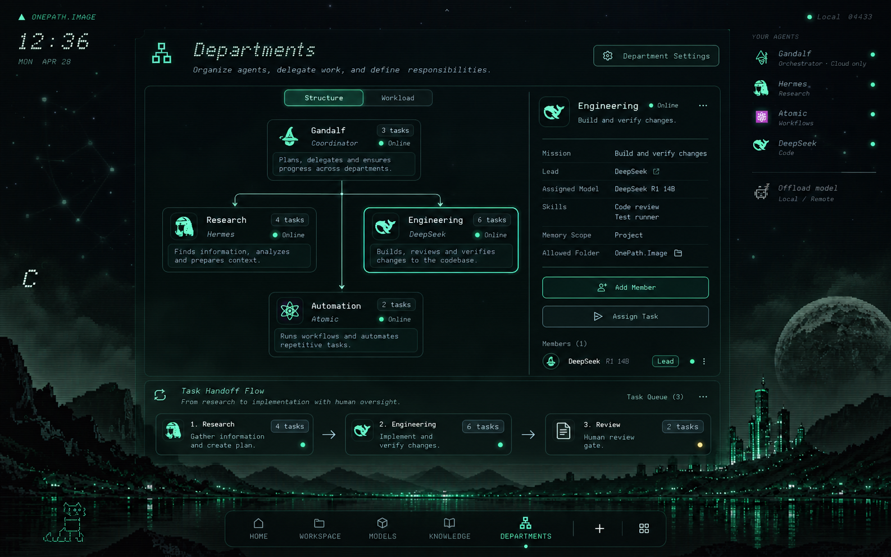

# OnePath.Image — Agent OS concepts

Five proposed launcher spaces for a local agent management system. These are generated design concepts with illustrative data, not implemented screens. The existing live dashboard is unchanged.

The spaces share one persistent shell: landscape, stars, agent rail, NAVI, compact clock and bottom navigation. Switching spaces would replace the central interface within the same page. Home retains the large clock; other spaces move it to the top left. Users could swipe between spaces and arrange widgets.

[Download all five images as a ZIP](../downloads/launcher-concepts-v1.zip)

## 1. Home — personal launcher

A calm entry point with clock, greeting, focus control, resumable work and resource widgets. Add and arrange widgets to make the space your own.

## 2. Workspace — run and supervise tasks

Agent conversation, task history, execution plan, tool activity, logs, generated files and an approval review area. Keep a long-running task visible while composing the next instruction.

## 3. Models — local inference control

Manage installed models, load or offload them, inspect hardware usage, adjust inference settings and connect local model runtimes.

## 4. Knowledge — skills and memory

Browse and assign skills; organize personal, project, shared and agent memories. Inspect sources, versions, folder access and tool permissions alongside the selected item.

## 5. Departments — coordinate an agent team

Arrange agents into departments with responsibilities, assigned models, shared skills and memory. Inspect workload, route handoffs and review work before it moves onward.

## Scope and image quality

These images demonstrate interface direction and intended capabilities. They do not indicate that model execution, memory storage, tools or approvals are already connected. Small text and icons in generated concepts are illustrative; implementation would use real typography and controls. PNG files retain their native generated resolution; this package is not a 4K export.
