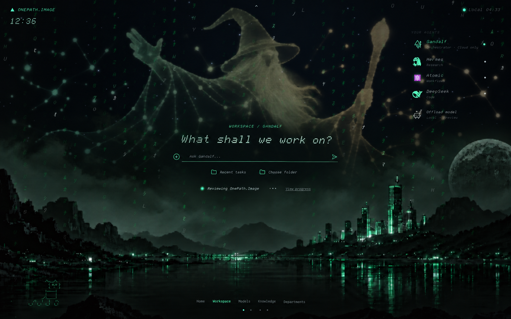

# OnePath.Image — Minimal launcher direction

Revised Workspace concept following the original home screen: open scenery, small clock at top left, one central prompt, quiet navigation, and details opened on demand.

## Interaction direction

- Workspace: one prompt and a discreet active-task line. Select a task to see its conversation and progress; open logs only when needed.
- Models: show the current model and a Change action. Selecting it opens a searchable model list; settings belong inside the selected model.
- Knowledge: search first, with Skills and Memory as two simple choices. Open one item to edit it.
- Departments: show department names and short responsibilities. Open one department to manage its agents and handoffs.
- Home: keep the original clock, atmosphere, and focus interaction.

Each space has one primary action and a clear back path. Secondary controls appear when relevant. Navigation swaps central content inside the same page.

Generated design preview with illustrative content, not an implemented UI. Existing live dashboard unchanged. Native PNG resolution: 1586 × 992.
