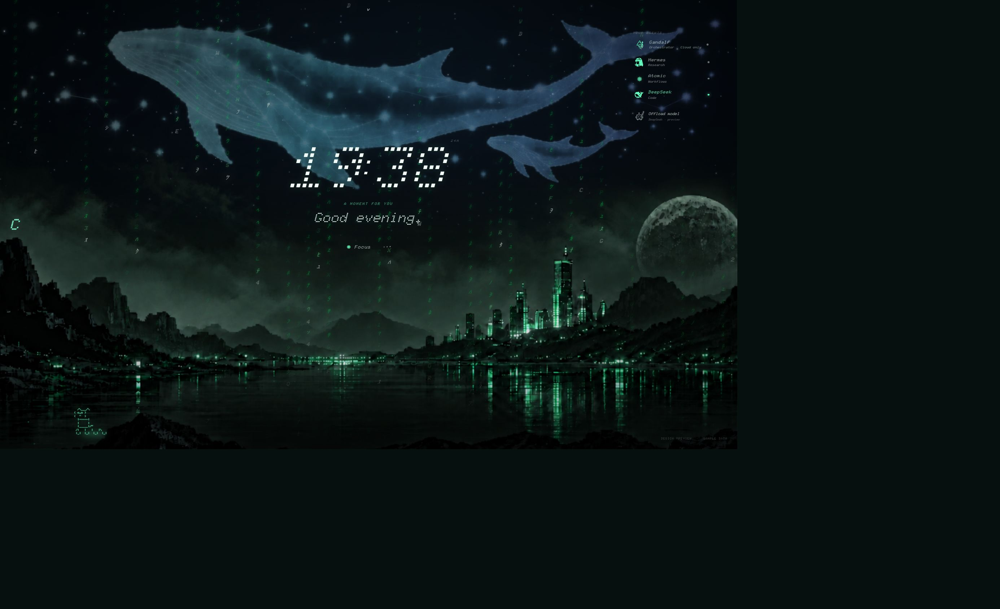
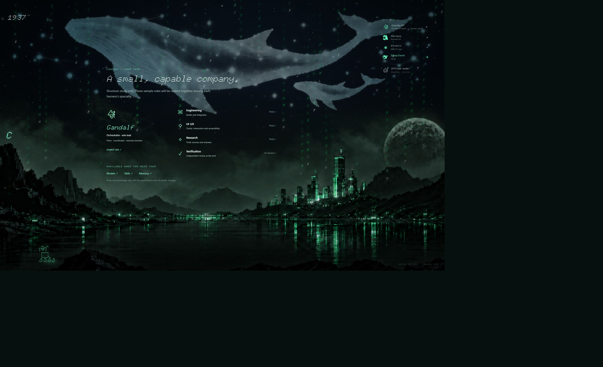
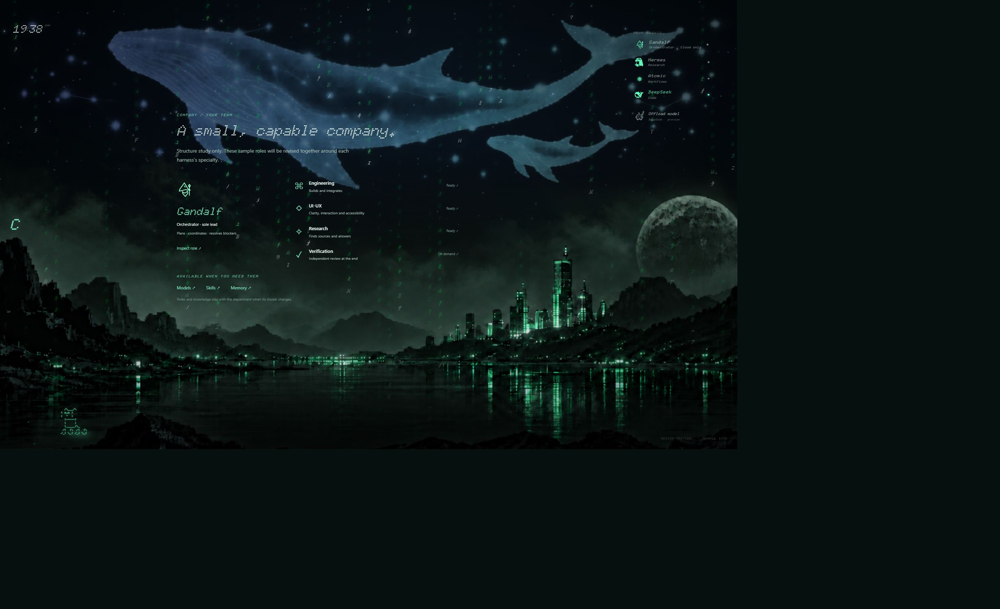

# Three-space discussion draft

**Provisional draft, awaiting owner review.** The owner asked to review a revised plan before implementation. This separate prototype was started too early. Its company/departments mapping came from Codex AGENTS.md and is **not the intended product architecture**. The product will be designed together around each harness's specialty. Do not adopt the sample hierarchy or model policies as requirements.

[Open interactive draft](https://musangman94.github.io/OnePath.Image/OnePath.Image/os-preview-v2/index.html#home) · [Download portable preview](../downloads/os-preview-v2.zip)

## What is here

- **Home:** reuses the current live page and scenery.
- **Workspace:** sample conversation, task state, composer, plan review and history on demand.
- **Company:** provisional organization sketch; role and resource details open on demand.
- **C:** the only control for switching between the three spaces.
- Clock reduces into the top left outside Home. The shared Home frame stays mounted through navigation.
- Models, skills and memory use one detail area. Sample memory edits last only for the preview session.
- Sample plans, assignments and messages do not start agents or connect to a backend.

## For our next discussion

1. What is each harness best at, and which owner use cases should it own?
2. How should the owner choose a harness or let the system choose one?
3. Which shared resources and task information should be visible, and which should open on demand?
4. Do Home, Workspace and a third management space make sense once those answers are clear?

Keep the original direction: quiet retro typography, open space, no panels/cards/borders or hover underlines, C navigation, preserved scene and NAVI, typing-safe shortcuts. The three-space choice itself remains a proposal.

## Running locally

Serve the repository root with `python -m http.server 8766`, then open `/OnePath.Image/os-preview-v2/index.html`. The portable ZIP contains the preview and its existing Home/asset dependencies; serve its extracted root the same way.

## Screenshots

These are browser captures of the discussion draft, not approved designs.

