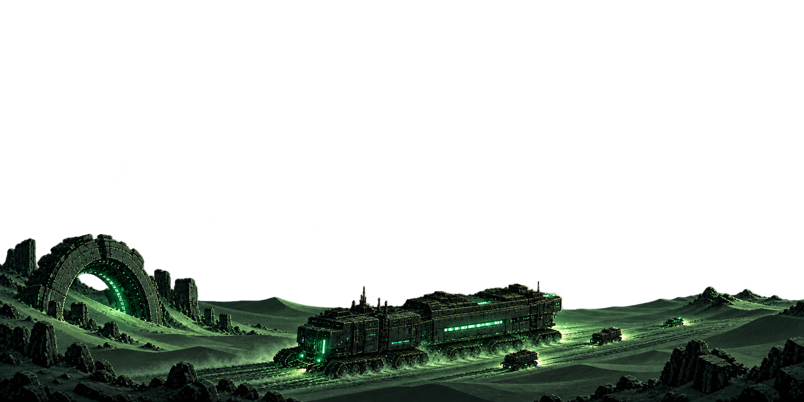
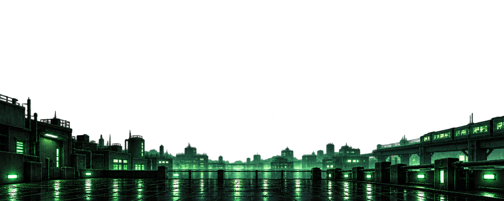
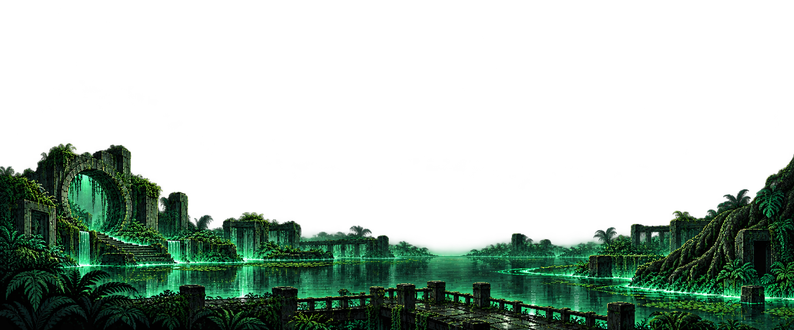
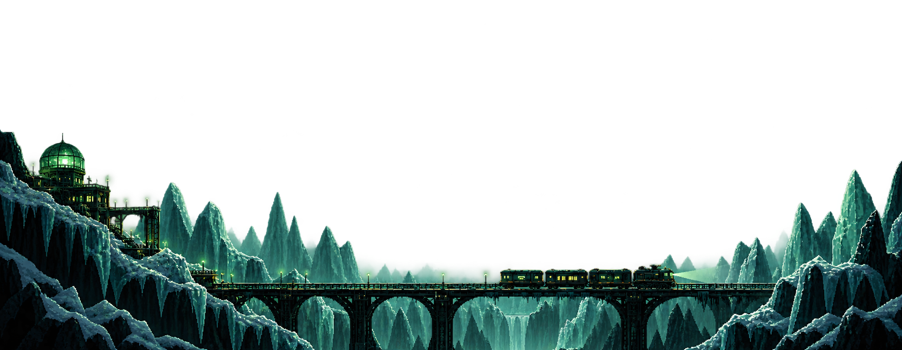
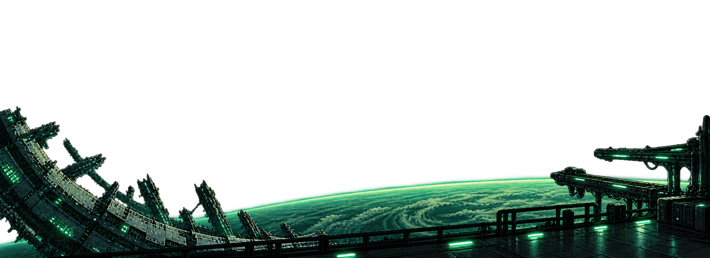

# Transparent landscape wallpaper review — v3

Five imagegen-created PNG overlays with alpha transparency, lower-screen scenery and baked-in green bloom. Open upper centers leave room for the separately rendered stars and constellations. Not applied to the live dashboard yet.

These are native generated dimensions, not 4K exports.

## 01-dune-crawler.png

1774 × 887 pixels, RGBA PNG.

## 02-neon-city.png

1983 × 793 pixels, RGBA PNG.

## 03-drowned-temple.png

1942 × 809 pixels, RGBA PNG.

## 04-ice-valley.png

2012 × 781 pixels, RGBA PNG.

## 05-orbital-platform.png

2078 × 757 pixels, RGBA PNG.

## Integration note

Use these PNG alpha channels directly when adding them to the landscape canvas. The existing wallpaper renderer derives alpha from luminance; that must be adapted for these transparent assets. Anchor the scenery to the bottom of the viewport when fitting it to different screen shapes.
