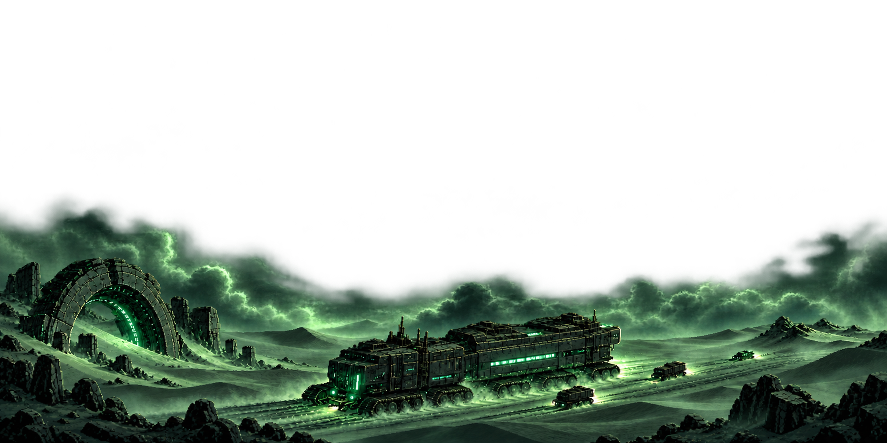
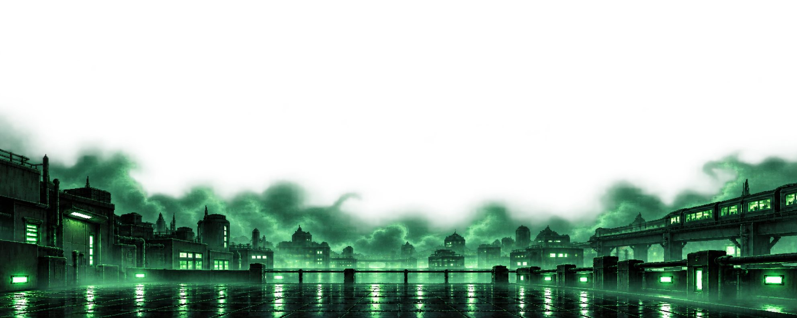
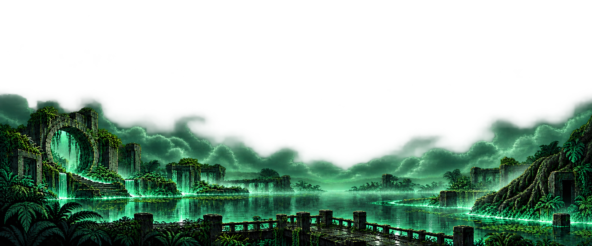
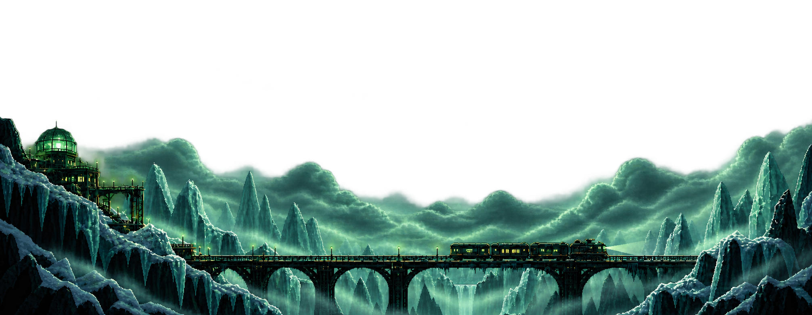
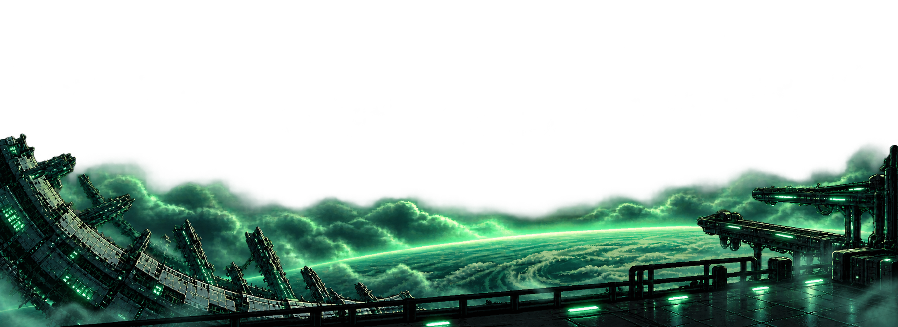

# Atmospheric wallpaper overlays — v4

Five revised transparent PNG foregrounds with low cloud banks, horizon haze and green-lit fog to blend with the separately rendered star and constellation layers. Baked-in emerald bloom is retained.

Native generated dimensions are listed below; these are not 4K exports. Review images only: the dashboard has not been switched to these wallpapers.

## 01-dune-crawler

1774 × 887 pixels.

## 02-neon-city

1983 × 793 pixels.

## 03-drowned-temple

1944 × 809 pixels.

## 04-ice-valley

2012 × 782 pixels.

## 05-orbital-platform

2078 × 757 pixels.

## Integration

Anchor the landscape to the bottom. Preserve the supplied alpha channel when drawing the PNG: the current renderer calculates opacity from luminance and needs adaptation before applying these overlays. The semitransparent fog should composite over the constellation and stars.
