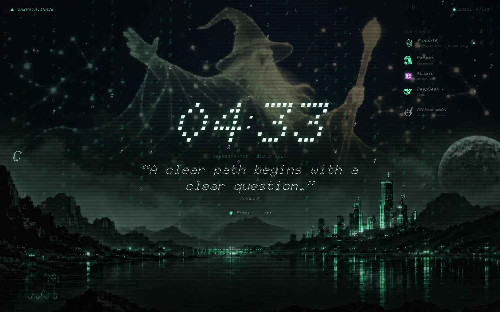
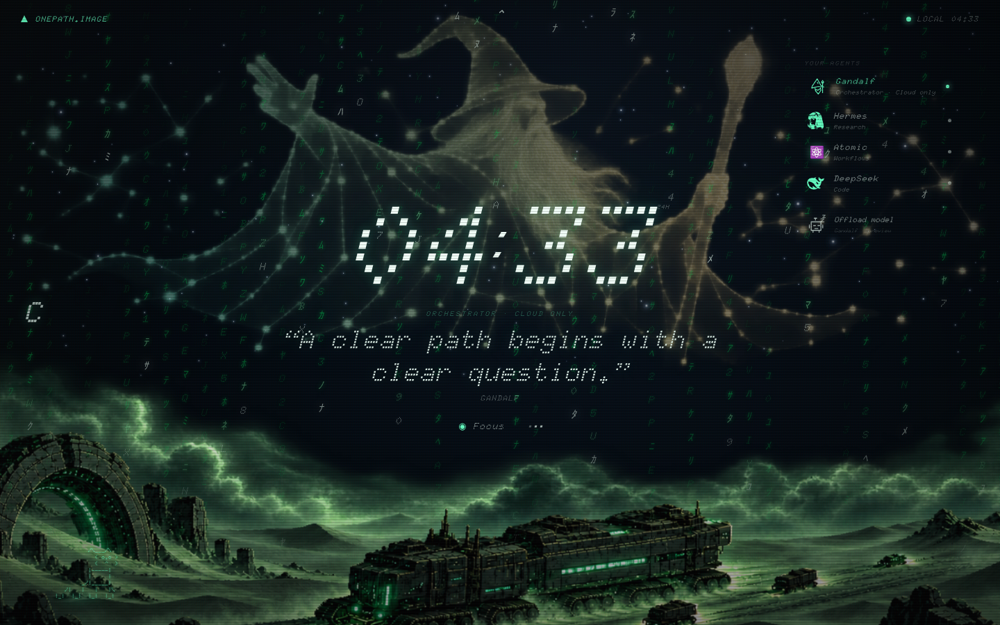
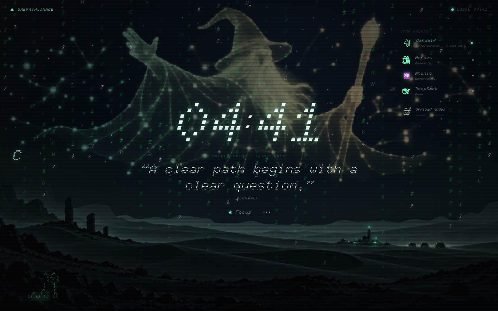
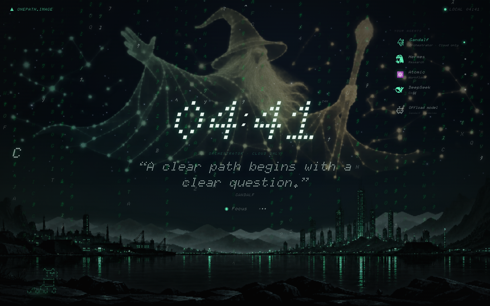
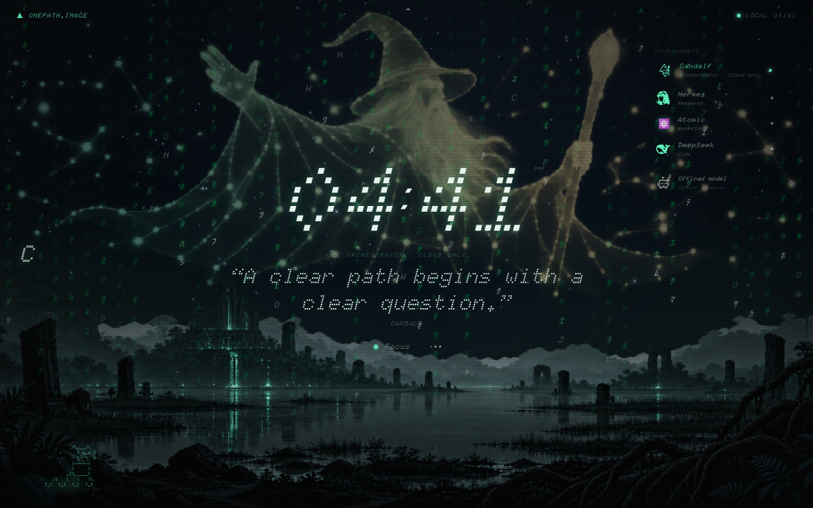
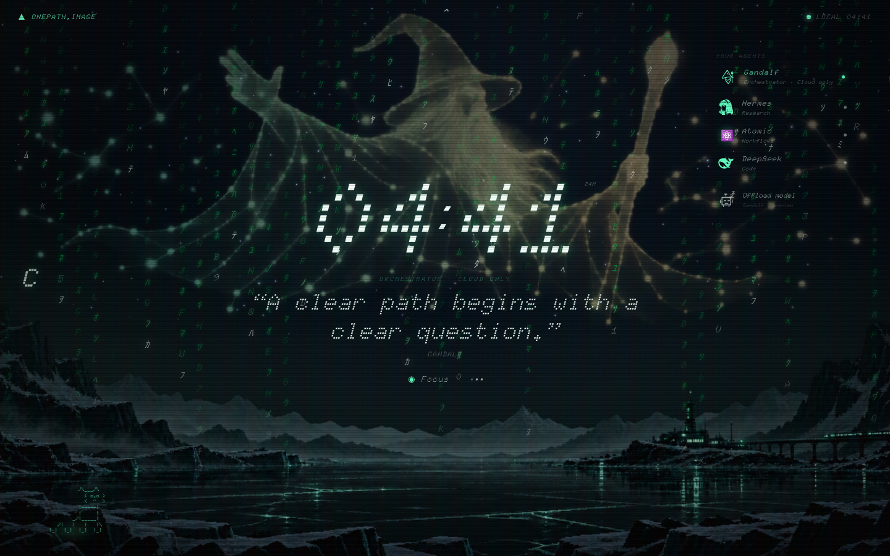
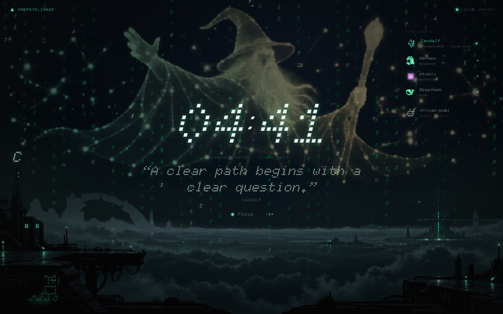

# Art-direction review

Compared the original and all five v4 wallpapers inside the same 1440 × 900 dashboard, using the same agent, motion preference and CRT setting. Screenshots have different clock values and random rain/star patterns; those differences do not indicate wallpaper changes.

## What the original gets right

The original reads as a distant world, with the clock and constellation in front. Its terrain is predominantly near-black, green is carried by sparse mint lights and narrow reflections, and soft haze separates receding landforms. Low peripheral terrain frames an open middle. A distant city is the focal point without becoming a foreground object. The scenery supports the interface hierarchy.

## What the five replacements lacked

| Scene | Problem in version 4 | Direction in version 5 |
|---|---|---|
| Desert | Large crawler and monumental gate occupied the foreground. Elevated viewpoint and bright olive-green terrain compressed the distance. | Low eye-level dune sea, broad receding ridges and a tiny distant convoy/waystation. Dark sand with small mint accents. |
| City | Foreground paving, railing and a full horizontal row of similar buildings made a shallow stage. Broad green illumination competed with text. | View across dark water toward a distant asymmetrical city, sparse lights and quiet reflections. |
| Temple | Huge glowing portal, bright foliage and dense detailing made the setting feel enclosed and close. | A distant stepped sanctuary across a broad wetland, peripheral roots and subdued vegetation. |
| Ice | Broad bright cyan faces, repeated spikes and a full-width bridge created a barrier across the page. | A dark frozen inlet, receding ridges and a small far-shore outpost with a short distant viaduct. |
| Orbital | Large ring, nearby platforms and a bright planetary rim filled the foreground with competing objects. Thick weather clouds also muddied the orbital setting. | A distant high-atmosphere port over dark cloud decks, small docking elements and sparse lights. |

The v4 fog was also too similar across all five: bright, scalloped cloud walls with glowing contours. It defined a visible upper edge instead of dissolving the landscape into the background. Bloom was applied over too much area; the original confines its brightest glow to actual light sources.

## The gap also came from rendering

It was not solely an illustration problem. The original image is about 1.60:1, while the v4 overlays range from about 2.00:1 to 2.75:1. The overlay renderer fitted them to a minimum of 72% viewport height, bottom-anchored them and applied 1.16× scaling. Combined with the artwork's empty upper area, this pushed the visible scenery low and cropped near objects at the bottom.

The revised renderer fits the full viewport and uses 1.06× bottom-origin scaling with smaller parallax travel. A subtle low-contrast atmosphere rises behind the terrain, and a vertical alpha mask softens distant upper edges. The original wallpaper keeps its existing rendering. This reduces the disconnected band while keeping the constellation and stars visible.

## Color and exposure

The old variants were too broadly illuminated and often shifted toward yellow/olive or vivid cyan. For context, mean RGB over the bottom third of the source files was roughly (12,23,19) for the original, (50,78,56) for the v4 desert and (42,92,63) for the v4 city. These are simple encoded RGB averages, not physical luminance measurements; transparency and scene content differ. They support the visual observation that the replacement scenery was much brighter.

The new batch restores darker charcoal/teal shadows, smaller emissive accents and localized bloom. The ice and cloudport remain intentionally cooler. These are stylistic matches, not exact color-calibrated reproductions; the original remains the reference when choosing a final direction.

## Dashboard comparisons

### Original

### Desert before

### Dune sea after

### Distant city after

### Sunken sanctuary after

### Glacial inlet after

### Cloudport after

## Validation

All six wallpaper choices passed loading, upper-sky alpha, lower-scenery, selected-state and reload-persistence checks at desktop, mobile and 3840 × 2160 viewport sizes. Failed image loading retains the last working landscape. Image files themselves remain native resolution, not 4K.
