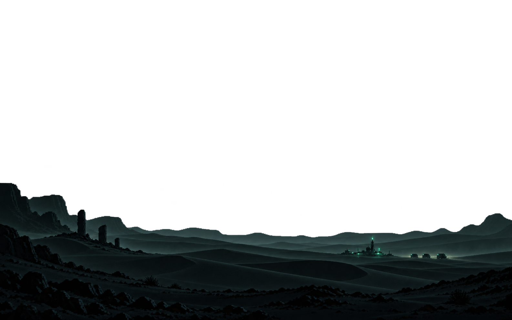
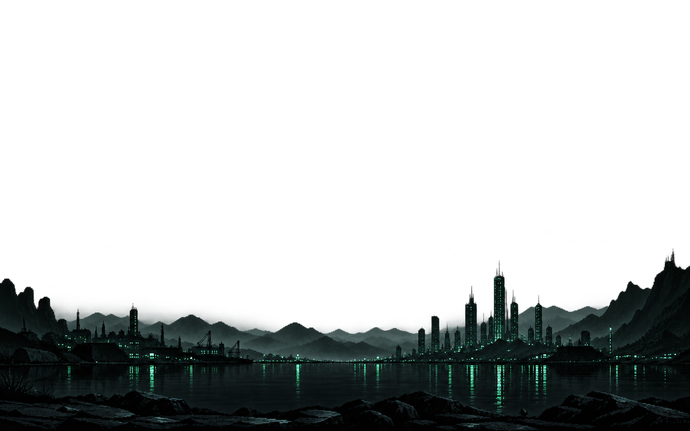
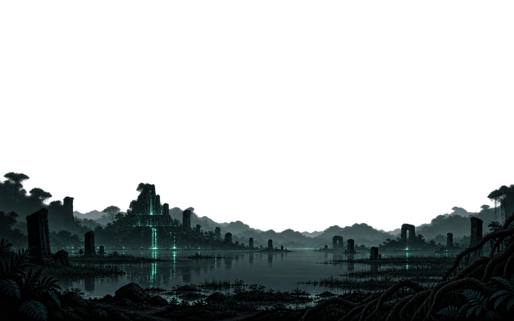
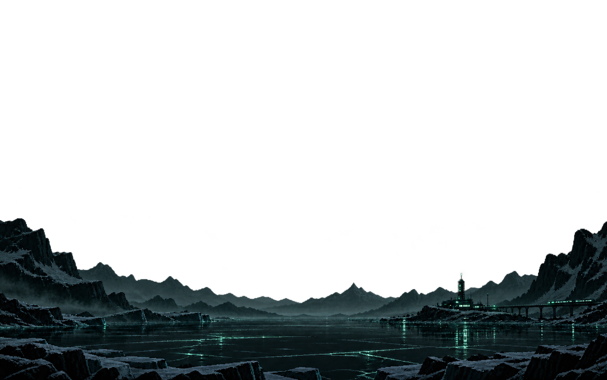
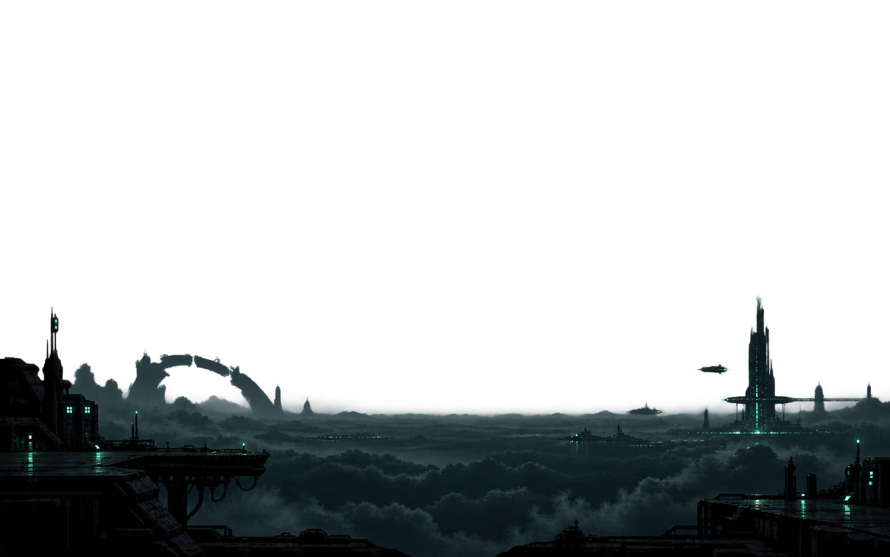

# Wallpaper revision 5 — distance, restraint and atmosphere

The five images have been regenerated using the original wallpaper as the exposure and composition reference. The dashboard renderer now fits overlays to the full viewport, reduces parallax cropping and supplies a subtle atmospheric transition. Existing saved wallpaper selections continue to work.

[Read the art-direction analysis and dashboard comparisons](ART-DIRECTION.md).

[Earlier cloud overlap checks](CLOUD-BLEND-CHECKS.md). The shared cloud layer now uses the same DeepSeek-based height for every agent, with parallax movement and its 10% response lag preserved. [Fixed-height verification](FIXED-BLEND-HEIGHT.md).

Native generated dimensions are listed below. These are not 4K exports. PNG alpha is preserved.

## 01-dune-sea

1586 × 992 pixels.

## 02-distant-city

1585 × 992 pixels.

## 03-sunken-sanctuary

1586 × 992 pixels.

## 04-glacial-inlet

1585 × 992 pixels.

## 05-cloudport

1585 × 992 pixels.

[Wallpaper dimensions and synchronized movement checks](MOTION-CHECKS.md). The cloud response is now 10% slower, with the same final displacement as the landscape.
