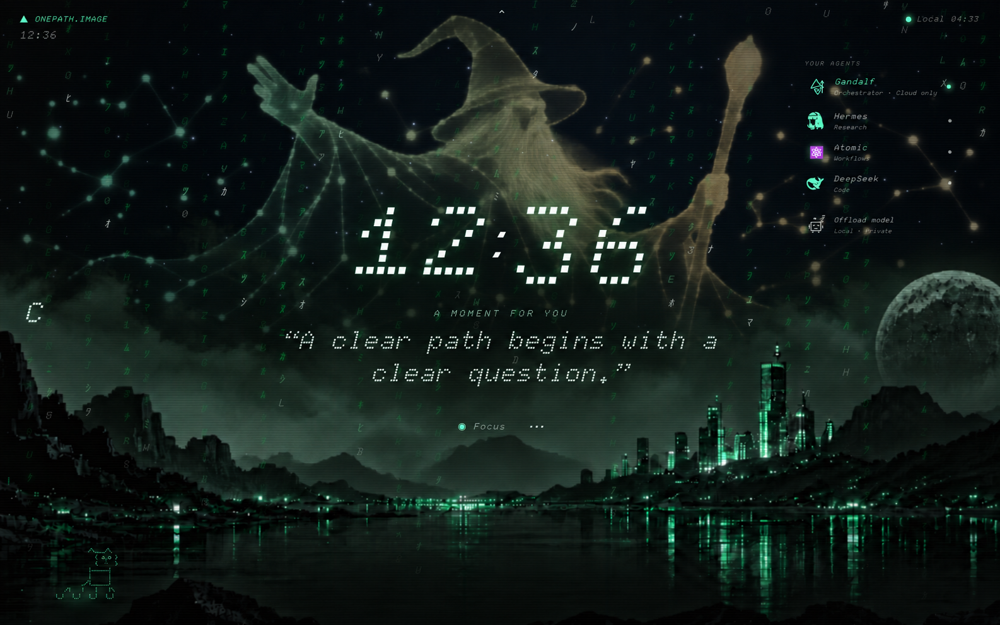
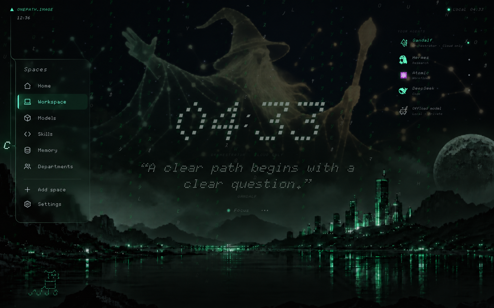
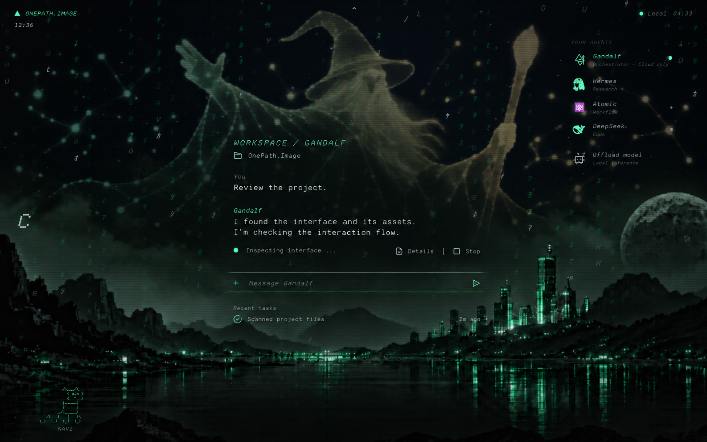
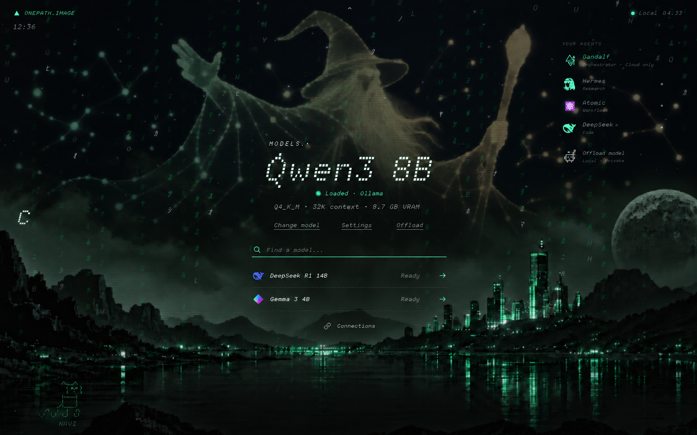
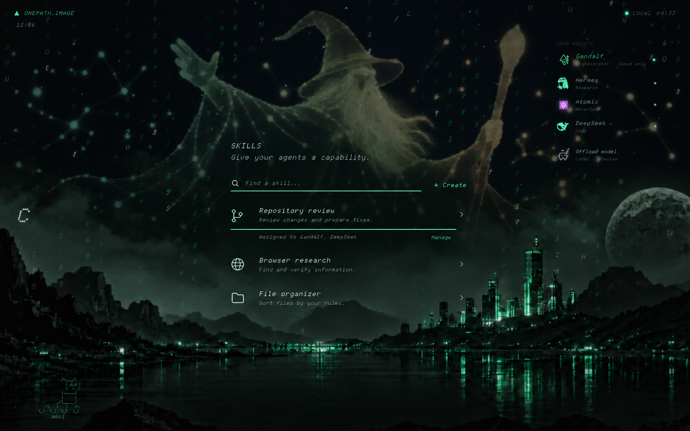
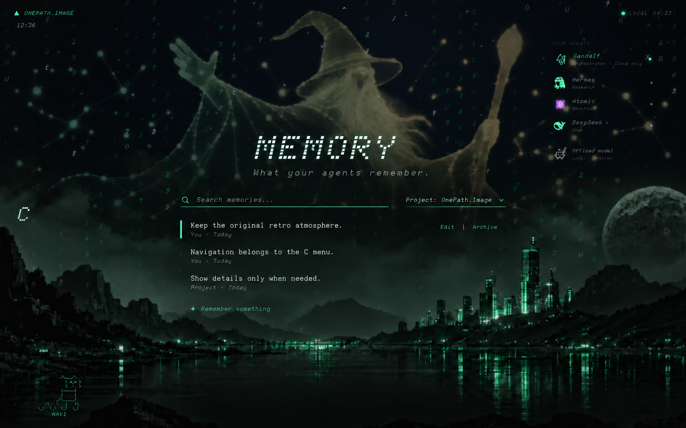
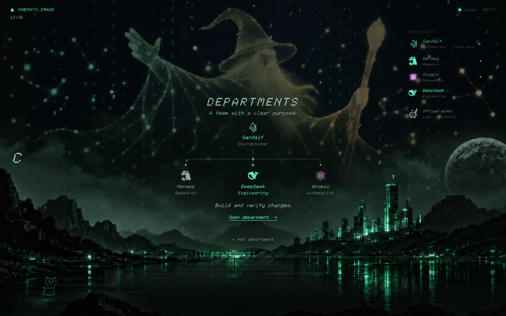

# OnePath.Image — Complete web OS preview

Seven full-screen concepts showing a shared, minimal retro interface. The C icon is the only space-navigation control. The original landscape, constellation, agent rail and NAVI remain present across spaces; the clock minimizes outside Home. Secondary details open when selected.

[Download the complete preview ZIP](../downloads/web-os-preview-v1.zip)

## Home

The original calm entry point: clock, greeting and focus.

## C menu

The space selector opened from C. It closes after choosing a destination.

## Workspace

Agent conversation, a discreet running-task status and one message input. Task details and history open on demand.

## Models

Current model, simple load/offload actions and a searchable model list. Settings and connections open separately.

## Skills

Find a capability, see its purpose and manage its agent assignments.

## Memory

Search remembered context by scope and edit one entry at a time.

## Departments

A simple team structure with clear responsibilities. Open a department to manage its members and work.

These are generated design previews with illustrative content, not implemented screens or connected backend capabilities. Minor typography and icon variations are conceptual. The live dashboard is unchanged. Images retain their native generated resolution; this is not a 4K export.
